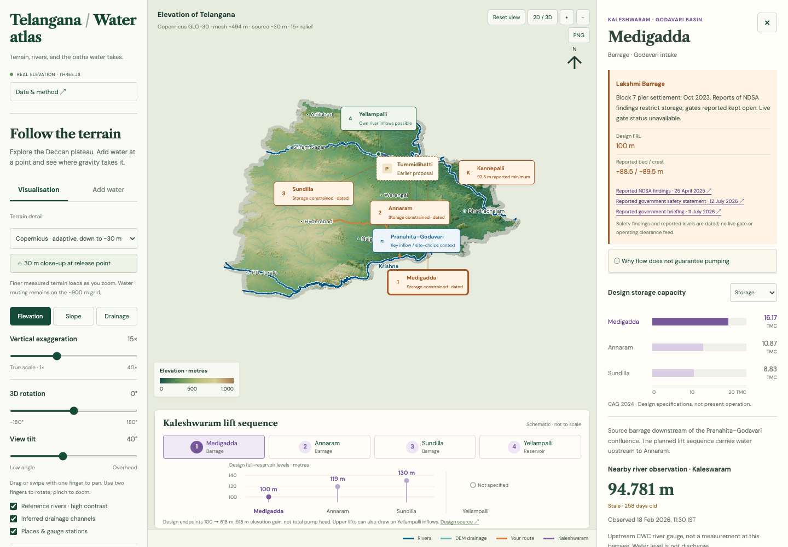
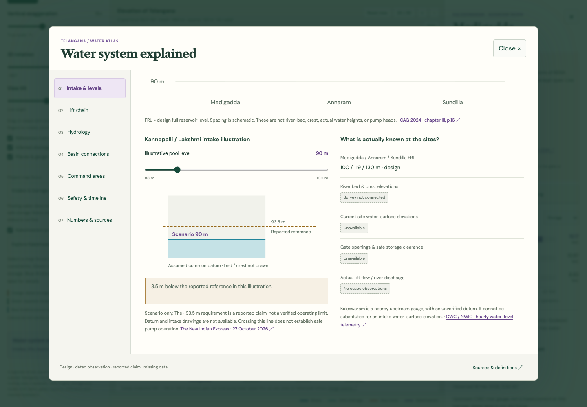
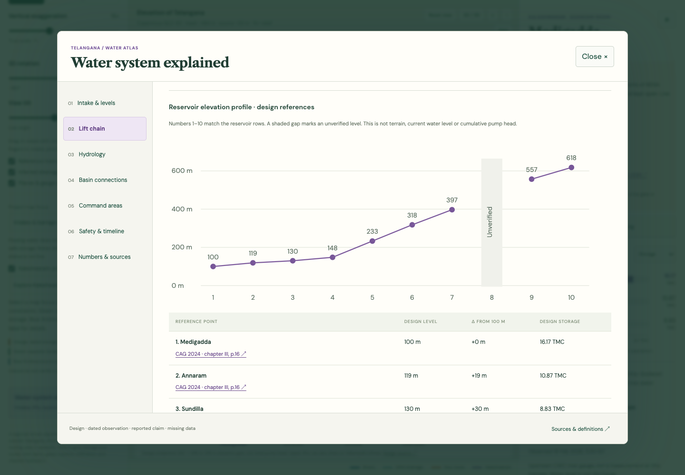
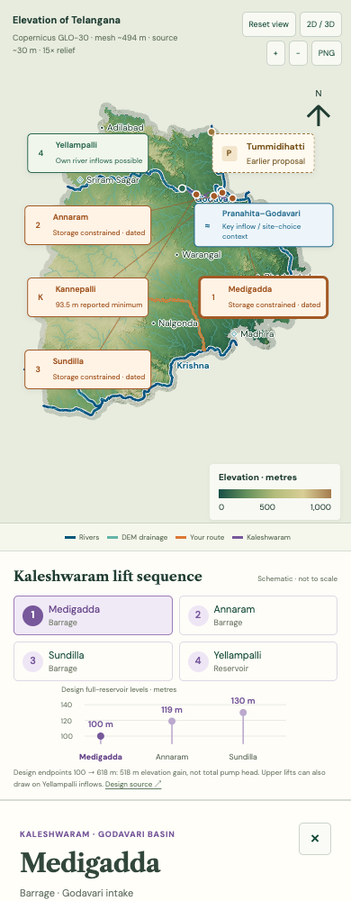

<div align="center">

# Telangana Water Atlas

### Explore the terrain. Follow the water. Understand the system.

An interactive, source-linked atlas of Telangana's terrain, rivers and irrigation projects.

[](https://github.com/krngd2/telangana-water-atlas/actions/workflows/ci.yml) [](LICENSE) [](#read-the-map-responsibly) [](.nvmrc)

[Live demo](https://telangana-water-atlas.pages.dev/) · [Get started](#run-it-locally) · [What you can explore](#what-you-can-explore) · [Data & methods](docs/data-and-method.md) · [Contribute](CONTRIBUTING.md)

</div>



*Real app capture. Display terrain reaches approximately 30 m sampling; water routing uses a separate approximately 900 m grid. [Screenshot credits](docs/screenshots/README.md).*

## Why this exists

Water debates often mix together river flow, reservoir storage, pump intake levels,
project design and water actually delivered. Geography helps separate those questions.

This atlas brings terrain exploration and evidence-backed project explanations into
one place. Pick a point, trace a possible route, inspect the lift chain, and follow
the sources behind a claim. It is built for curious residents, students, educators
and contributors who want a clearer picture of Telangana's water systems.

## What you can explore

| Explore | What it helps explain |
| --- | --- |
| **Terrain at two scales** | Zoom from a statewide overview into native Copernicus GLO-30 surface samples. Compare elevation, slope and contributing drainage area. |
| **Fill & spill routes** | Pick a release point and inspect a potential downstream path. Compare it with first collection and estimate storage at the first modelled depression. |
| **Kaleshwaram, stage by stage** | Inspect Medigadda, Kannepalli, Annaram, Sundilla, Yellampalli and upper-system reference points, with dated constraints and source links. |
| **Intake depth and storage** | Use an explicitly illustrative water-level slider to understand why flowing water alone does not establish pumpability. |
| **Tummidihatti and site choice** | Read the earlier Pranahita–Chevella context, audit findings, availability assumptions and the limits of alternative-design comparisons. |
| **Basin and command context** | Distinguish Godavari and Krishna sources and inspect thirteen intended-command district callouts. |
| **Published gauge observations** | Inspect dated CWC / NWIC water levels with freshness, failure and missing-data states. |
| **Shareable views and images** | Keep supported selections in the URL and export a PNG with view settings, credits and model limits. |

### Inside the atlas

| Why intake depth matters | How the lift stages connect |
| --- | --- |
|  |  |

<details>
<summary><strong>See the mobile experience</strong></summary>
<br>


Mobile supports touch panning, pinch zoom, two-finger rotation, tap-to-open details
and keyboard-accessible controls. A 2D fallback keeps the explanation available
when WebGL cannot start.

</details>

Screenshots show the bundled observation snapshot, not a live operating status.
[Capture instructions and attribution →](docs/screenshots/README.md)

## Run it locally

**Prerequisites:** Node.js **24 LTS** recommended; Node.js **22.12+ in the 22.x line**
is also supported. Use npm and a modern browser with WebGL for the 3D view.

```sh
git clone https://github.com/krngd2/telangana-water-atlas.git
cd telangana-water-atlas
npm ci
npm run dev
```

Open **http://127.0.0.1:5173**. If you use nvm, run `nvm use` first.

The repository includes approximately **684 MiB of prepared source and data**,
including **6,820 terrain tiles across 20 geocells**. The larger checkout makes
normal exploration and builds independent of upstream data services. Terrain
loads progressively in the browser; visitors do not download the full archive
at startup. **No API key, database or Python installation is required to run it.**

A good first visit:

1. Pan around the state and switch between elevation, slope and drainage.
2. Open **Add water**. Pick a location; **Fill & spill route** is the default.
3. Open **Water system explained** to explore intakes, lift stages and sources.
4. Zoom in with **30 m close-up at release point** and compare the display detail
   with the separate routing resolution.

## Read the map responsibly

> **Educational terrain and project explainer.** This atlas does not provide
> flood forecasts, dam-safety certification, surveyed inundation boundaries,
> or clearance to operate pumps or gates.

- **Display detail is not model detail.** Copernicus terrain reaches approximately
  30 m sampling. Routing, storage estimates and route profiles remain on the
  approximately **897 × 941 m** regional grid.
- **A water level is not discharge.** Gauge datums are unverified, readings are
  dated, and no rating curve converts them into cusecs here.
- **A reported reference is not an operating rule.** The 93.5 m intake reference
  is attributed to dated reporting. Present site levels, gate positions and
  safe-operation clearance are not verified by this app.
- **Design is not delivery.** Reservoir design capacity, live storage, intended
  command area, constructed network and irrigation delivered are different quantities.
- **An edge is a model limit.** Terrain and rivers extend approximately 8 km
  outside the state for context; routing still ends at the Telangana study mask.

Missing evidence is labelled rather than filled with a guess. See
[methods, assumptions and evidence limits](docs/data-and-method.md).

## Build, test and host

```sh
npm test                 # Data hashes, routing invariants and evidence contracts
npm run build            # Verify bundled assets, then build the static site
npx playwright install chrome
npm run test:browser     # Desktop, mobile, static hosting, exports and fallback
npm run preview          # Preview dist/ locally
```

Browser tests start the development server automatically. On Linux, browser setup
may require `npx playwright install --with-deps chrome`.

Release checks on 3 November 2026: **27 unit tests and 26 browser tests passed
locally**, and the production build passed. Hosted Actions is currently blocked
before test execution by an account-level restriction; the badge reflects that
state. [Validation record and remaining limits →](docs/open-source-qa.md)

Publish the complete **`dist/`** directory to a static HTTP(S) host. The production
app has **no backend, runtime data proxy, external fonts or required provider API
calls**. For hosting beneath a path, use:

```sh
npm run build -- --base=/telangana-water-atlas/
```

The [public demo](https://telangana-water-atlas.pages.dev/) is hosted on
Cloudflare Pages, with GitHub `main` connected for automatic builds and
deployments. The original release used Wrangler direct upload.
[Maintainer deployment instructions →](docs/cloudflare-pages.md)

Optional gauge checks reload the publisher's static JSON; they do not contact
CWC or create fresh observations.
[Data-update details →](docs/data-and-method.md#static-deployment)

## Data and architecture

**Three.js + plain JavaScript + Vite.** SVG/DOM explanations sit alongside adaptive
WebGL terrain; Node and optional Python scripts prepare the bundled data.

| Input | Source | Role |
| --- | --- | --- |
| Display surface | Copernicus GLO-30, 2021 AWS release | Adaptive terrain down to native 1-arc-second samples |
| Routing elevation | Mapzen / Tilezen Terrain Tiles | Regional DEM, D8 routes and depression storage |
| State outline | DataMeet / Election Commission of India via geoBoundaries | Study mask and display context |
| River centre lines | Natural Earth, 1:10 million | Generalised geographic context |
| Station observations | CWC / NWIC | Published, screened water-level snapshot |
| Project evidence | CAG, I&CAD, other official documents and labelled secondary reports | Design values, history, attributed claims and missingness |

```text
src/                  Terrain rendering, routing, project layers and explanations
public/data/          Prepared terrain, geometry, hydrology and gauge snapshot
public/licenses/      Distribution notices and upstream licence records
scripts/              Data preparation, verification and screenshot capture
tests/                Unit and browser coverage
docs/                 Detailed methods, evidence notes and real screenshots
```

Data preparation is optional. Python **3.10+**, NumPy and Pillow are needed only
for rebuilding the regional inputs; install them with
`python3 -m pip install -r requirements-data.txt`.
[Reproducibility and provenance →](docs/data-and-method.md#data-and-reproducibility)

## Help improve it

Useful contributions include **Telugu translation**, accessibility, clearer mobile
interactions, source corrections, reproducible data preparation, and independent
hydrology or engineering review. Technical review is especially welcome where
the atlas explicitly marks a missing or reported input.

Start with [CONTRIBUTING.md](CONTRIBUTING.md), then
[report a bug](https://github.com/krngd2/telangana-water-atlas/issues/new/choose),
[submit a data correction](https://github.com/krngd2/telangana-water-atlas/issues/new/choose),
or propose a focused improvement. Include a dated source and page/table reference
for factual changes. Please follow the [Code of Conduct](CODE_OF_CONDUCT.md).
For security concerns, use [private reporting](SECURITY.md).

## Licence, credits and citation

**Original code and documentation: [MIT](LICENSE).** Third-party datasets, fonts,
libraries and underlying map content retain their own terms in
[DATA_LICENSES.md](DATA_LICENSES.md). CWC / NWIC marks its dataset “Other (Open)”;
this repository does not turn that label into an MIT grant.

Produced using Copernicus WorldDEM-30 © DLR e.V. 2010-2014 and © Airbus Defence
and Space GmbH 2014-2018 provided under COPERNICUS by the European Union and
ESA; all rights reserved. The organisations in charge of the Copernicus programme
by law or by delegation do not incur any liability for any use of the Copernicus
WorldDEM-30. Source organisations do not endorse this project.

Credit also goes to the DataMeet and geoBoundaries communities, Natural Earth,
CWC / NWIC, Mapzen / Tilezen and its elevation providers, the Three.js authors,
and the DM Sans and Libre Caslon Text font authors.

If you use this work, cite **Sai Kiran, Telangana Water Atlas**, include the commit
or release you used, and separately credit the upstream datasets.
[Machine-readable citation →](CITATION.cff)
